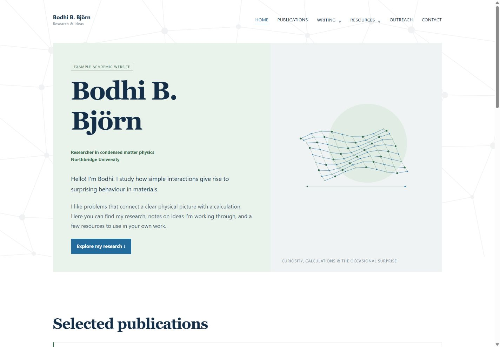

# Academic website template

A small academic website that you can make your own: research, publications,
Writing and Resources collections, outreach, and a shared contact footer.
Plain HTML, CSS and JavaScript, with a Python build script and no packages to
install. The examples belong to **Bodhi B. Björn**, a fictional researcher.

**[Live demo](https://pramodhyapa.github.io/academic-website-template/)** ·
**[Use this template](https://github.com/new?template_name=academic-website-template&template_owner=pramodhyapa)** ·
**[Download a ready-to-open ZIP](https://github.com/pramodhyapa/academic-website-template/releases/latest/download/academic-website-template.zip)**



## Start with the ready-to-open download

Download the release ZIP above, extract it, then double-click `index.html` in
the extracted folder. A built copy is included, so viewing it needs no Python
and no server. The ZIP also contains the editable source.

## Start from GitHub source

Choose **Use this template** to create your own repository, then clone it or
download its source. GitHub's green **Code → Download ZIP** downloads source
only; it is different from the prebuilt release ZIP.

Install Python 3.10 or newer, then run these commands from the project folder:

```sh
python build.py
python preview.py
```

On systems that name Python 3 `python3`, use that command instead. Open
<http://127.0.0.1:8767> and press Ctrl+C to stop. An optional port is supported:
`python preview.py --port 8770`. After editing, run `python build.py` and refresh
the browser. You can also open `dist/index.html` directly after building.

Only the generated `dist/` directory needs to go on a web host. It contains
ordinary static files and needs no Python on the server. Generated files and
Python caches are excluded from Git; edit the source, then rebuild.

## Make it yours

| File | What to change |
| --- | --- |
| `content/site.json` | Name, role, affiliation, email, introduction, social links, optional CV URL and background motion |
| `content/publications.json` | Publications, summaries, abstracts and links |
| `content/education.json` | Degrees, fellowships or experience |
| `content/catalog.json` | Writing/Resources titles, summaries, dates, images and body-file locations |
| `src/writing/` | Article bodies, written as ordinary HTML |
| `src/resources/` | Resource descriptions, written as ordinary HTML |
| `src/downloads/` | Files that you intend to distribute publicly |
| `src/assets/` | Images, CSS and JavaScript |
| `src/page.html` | Shared page shell, navigation placement and contact/footer markup |
| `build.py` | Homepage and collection layout |

1. Edit `content/site.json`; set `demo` to `false` after replacing the sample
   content. This removes the sample website labels.
2. Replace the two fictional publications and degrees. A publication's `links`
   can contain objects such as `{"label": "Paper", "url": "https://…"}`.
   Leave `abstract` empty to hide its disclosure.
3. Replace the illustrations with your own images, or retain these original
   geometric placeholders while prototyping. No user portrait is included.
4. Add social profiles as `{"label": "Profile name", "url": "https://…"}`
   objects in `socials`. Leave the array empty to omit them.
5. Set `cv_url` to a public URL or a relative path such as `downloads/cv.pdf`
   and add that file to `src/downloads/`. An empty value hides the button.
6. Run `python build.py` after every content change. Do not edit `dist/`
   directly: changes there are overwritten by the next build.

Email addresses are displayed with `(at)` but the mail link contains the actual
address. This is a presentation choice, not protection from harvesting.

## Add an article or resource

Create a body file, for example `src/writing/my-new-article.html`, then add an
entry to `content/catalog.json`:

```json
{
  "slug": "my-new-article",
  "collection": "writing",
  "title": "My new article",
  "label": "Essay",
  "category": "Research notes",
  "date": "2026-11-17",
  "summary": "One or two sentences about what the reader will find.",
  "image": "assets/notebook.svg",
  "body": "writing/my-new-article.html"
}
```

Use `resources` as the collection for a reusable tool, guide or template.
Add `"download": "downloads/my-file.ext"` to show a download button and put
the file in `src/downloads/`. An article can contain arbitrary HTML, so a future
interactive figure is not constrained by a Markdown format.

Run `python build.py`. The build updates the collection, the newest homepage
writing entries and both menus. Entries sort newest first by `date`, then by
optional numeric `order` (larger first) for ties. The menu shows at most three
entries by default; `latest_menu_count` allows one to five, followed by a
permanent “View all” link. Categories come from the entries. Search appears
automatically at six entries. With JavaScript disabled all entries remain
visible and navigation still works.

The build checks duplicate slugs, dates, local links, images, downloads and HTML
anchors. It does not check external websites. Content files are trusted local
authoring inputs; this is not a CMS for untrusted submissions.

Run `python tools/check_build.py` to exercise catalogue growth, menu limits,
search visibility, entry removal and broken-download detection in a temporary
copy. It leaves your project content unchanged.

To remove an entry, remove it from the catalogue and rebuild. The build removes
its previously generated page; delete its unused source and assets yourself.
If deploying by uploading files, make sure removed pages are also removed from
the host.

## Styling and motion

Colours, typography and spacing are in `src/assets/site.css`. Fonts use the
reader's installed system sans-serif and Georgia/Times serif; no font files or
external font service are included. The illustrations and network geometry
were created for this starter by `tools/make_art.py`.

Set `network_motion` to `false` for a static network. Motion also respects
`prefers-reduced-motion` and stops updating in a hidden tab. The network and
the sample wave are illustrative animations, not research simulation data.
There are no decorative pause buttons. The wave control demonstrates a
labelled interactive figure; replace or remove the entire sample if unneeded.

## Publish your own website

### GitHub Pages

1. Create your repository with **Use this template** and replace the example
   content in `content/`. Keep the licence and credits notices in the source.
2. In your repository, open **Settings → Pages** and select **GitHub Actions**
   as the build source. If prompted, enable Actions for your repository.
3. Push to `main`, or run **Actions → Build and deploy demo → Run workflow**.
4. The workflow checks the build and publishes only `dist/`. Its deployment
   summary contains your website URL.

The same relative links work at `username.github.io/repository-name/`, on a
custom domain, and in the offline build. For a user homepage, name the repository
`username.github.io`. No custom domain or `CNAME` from the author's site is
included. If you later configure a domain, follow GitHub Pages' domain settings.

### Another static host

Use `python build.py` as the build command and `dist` as the publish directory,
or upload the contents of `dist/` yourself. Exclude the two `.generated-*.json`
bookkeeping files from an upload if your host exposes hidden files. Keep them
in your local build directory so removed entries can be cleaned on later builds.

## Checks and releases

```sh
python tools/check_build.py
python tools/check_release.py
python tools/make_release.py
```

The checks cover catalogue growth and removal, bounded menus, search, local
assets and anchors, project-subdirectory hosting, release metadata and the
ready-to-open archive. Build checks also run on Linux and Windows with Python
3.10 and 3.14 in GitHub Actions. They do not contact external links.

`tools/make_release.py` rebuilds the website and creates
`release/academic-website-template.zip`. It packages the editable source and a
built `dist/`, with an opening page for offline use. It includes only the
documented source directories and release files, not Git history, caches,
credentials or unrelated files. The release directory is ignored by Git.

To publish a new version, run the **Publish release** workflow with an unused
semantic version tag such as `v1.0.1`. It runs the checks, packages the website,
and creates a GitHub Release attached to that commit. Only repository writers
can run that workflow. Existing versions are never overwritten.

## Licence and credits

The new starter code, sample content, documentation and generated artwork are
available under the **[MIT licence](LICENSE)**. Keep the licence notice in copies
or substantial portions. Visible footer attribution is welcome but not required.
Replace the fictional examples before publishing your own site.

This grew out of Pramodh Senarath Yapa's personal website, whose earlier themes
included **Future Imperfect by HTML5 UP / AJ**, **Sciento by Aspirity**, and
**Mundana by Sal / WowThemes.net**. Those authors retain credit for their work.
This starter uses a newly authored implementation and original placeholder
artwork; their theme source, stock assets and fonts are not bundled or relicensed.
See **[CREDITS.md](CREDITS.md)** for the evidence and exclusions.

OpenAI's Codex was used to help develop the implementation, examples, artwork
and documentation. There are no API keys, accounts or AI services required to
build or use the resulting website.
